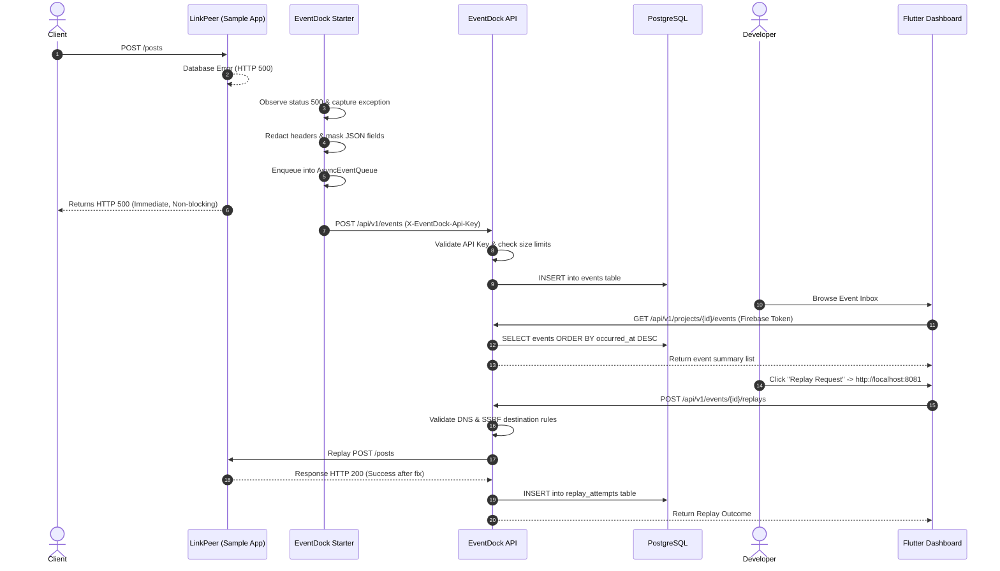

# About EventDock

## 1. What is EventDock?

**EventDock** is an enterprise-grade developer platform engineered to detect, inspect, and reproduce API failures in Spring Boot applications. It combines:
1. A lightweight, non-blocking Spring Boot Starter (`eventdock-starter`) that automatically observes HTTP failures, extracts exceptions, sanitizes sensitive data, and reports diagnostic events.
2. A scalable Spring Boot 3.4.x backend (`eventdock-api`) powered by PostgreSQL, Spring Data JPA, Hibernate, Flyway, and Firebase Auth for identity.
3. An interactive developer CLI (`eventdock-cli`) built with Picocli for terminal inspection and controlled request replay.
4. A responsive developer dashboard (`eventdock-dashboard`) built with Flutter Web for real-time failure triage, formatted stack trace inspection, and SSRF-safe request reproduction.
5. A reference application (`eventdock-sample`, LinkPeer) demonstrating practical integration and resilient behavior.

---

## 2. Why does EventDock exist?

When an API request fails in production, staging, or integration environments, developers typically endure a fragmented and time-consuming debugging process:
- Scouring distributed log aggregators for request correlation IDs and stack traces.
- Guessing what HTTP headers, parameters, or payloads caused the failure.
- Manually recreating curl commands or Postman requests to reproduce the bug locally.
- Inadvertently exposing sensitive customer credentials, authorization tokens, or passwords stored in application logs.
- Retrying requests blindly, risking state pollution or duplicate side effects.

EventDock solves these challenges by providing automated, safe diagnostic capture at the point of failure, centralized inspection, and single-click request replay against approved local or staging target URLs.

---

## 3. Who uses EventDock?

- **Backend Developers & Application Engineers**: Integrate `eventdock-starter` into Spring Boot microservices, inspect live errors, copy correlation IDs, and reproduce failures against local development machines (`localhost:8081`).
- **Platform Engineers & Tech Leads**: Manage projects, issue and revoke ingestion API keys, enforce retention policies (7, 14, 30, 90 days), and monitor application reliability.
- **QA & Test Automation Engineers**: Triage staging test run failures, verify error responses, and inspect diagnostic stack traces without requiring direct database or container shell access.

---

## 4. How EventDock works

1. **Failure Observation**: Incoming HTTP requests to the host application pass through `EventDockRequestFilter`. The filter assigns or propagates an `X-Request-Id` correlation header.
2. **Exception Capture**: If an exception occurs, `EventDockExceptionObserver` (implementing Spring MVC `HandlerExceptionResolver` with highest precedence) captures the exception without interfering with Spring's `@ExceptionHandler` or `ResponseEntityExceptionHandler` flows.
3. **Sanitization & Redaction**: `SensitiveDataRedactor`, `HeaderRedactor`, and `BodyRedactor` scrub sensitive headers (Authorization, Cookie, API keys) and mask sensitive JSON fields (password, token, secret) with `***REDACTED***`. Deep JVM reflection stack traces are truncated to configurable frame limits.
4. **Non-Blocking Asynchronous Queue**: The sanitized `DiagnosticEvent` is enqueued into `AsyncEventQueue`. If the queue is saturated, events are dropped with monitored metrics to guarantee that the host application's request thread is **never blocked** and **never degraded**.
5. **Ingestion & Persistence**: `HttpEventDockReporter` delivers the event to `eventdock-api` via `POST /api/v1/events` using the project API key. The backend validates payload limits and persists the event to PostgreSQL using Spring Data JPA.
6. **Triage & Replay**: Developers view failures on the Flutter Web dashboard or CLI. An authorized user can trigger a replay against an approved target destination. EventDock validates destination DNS and enforces SSRF restrictions before executing the replay and recording the replay attempt separately from the original event.

---

## 5. Real-World Example: LinkPeer `POST /posts` HTTP 500

Consider **LinkPeer**, a Spring Boot social platform:
1. A client sends `POST /posts` with headers `Authorization: Bearer token_xyz` and JSON body `{"title": "Dev Update", "password": "mypass"}`.
2. The LinkPeer database connection pool is exhausted, throwing `DatabaseConnectionException: PostgreSQL connection timeout`.
3. EventDock intercepts the failure:
   - Assigns correlation ID `corr-7a91b2c4` and attaches it to the response header.
   - Captures status code `500`, exception class `dev.eventdock.sample.exception.DatabaseConnectionException`, and formatted stack trace.
   - Redacts `Authorization` header and masks `"password": "***REDACTED***"`.
   - Asynchronously transmits the diagnostic event to EventDock API.
4. The LinkPeer API returns the expected HTTP 500 response to the client in under 5 milliseconds without waiting for EventDock.
5. The developer opens the EventDock Dashboard, sees the `POST /posts` 500 failure, inspects the sanitized stack trace, copies the request ID `corr-7a91b2c4`, and replays the request against their local Docker instance at `http://localhost:8081` to test their connection pool fix.

---

## 6. Technology Stack

| Component | Technology | Rationale |
| :--- | :--- | :--- |
| **Language** | Java 21 LTS | Pattern matching, virtual threads, modern switch expressions, enhanced performance. |
| **Framework** | Spring Boot 3.4.3 | Industry standard for production-ready, cloud-native Java services. |
| **ORM & Persistence** | Spring Data JPA & Hibernate | Declarative repositories, specification queries, robust entity lifecycle. |
| **Boilerplate Reduction** | Project Lombok | Clean models and entities with `@Data`, `@Builder`, `@Getter`, `@Setter`. |
| **Migrations** | Flyway 10.x / 11.x | Version-controlled, idempotent PostgreSQL database schema migrations. |
| **Database** | PostgreSQL 16 & H2 | Enterprise relational database for production, in-memory H2 for rapid integration tests. |
| **User Authentication** | Firebase Auth | Secure user identity management; backend validates Firebase ID tokens and maps them to local users. |
| **API Authentication** | SHA-256 Hashed API Keys | High-performance, cryptographically secure project ingestion keys (`ed_live_...`). |
| **API Docs** | SpringDoc OpenAPI (Swagger) | Auto-generated OpenAPI 3.0 documentation and interactive Swagger UI. |
| **CLI** | Picocli 4.7.6 | Feature-rich command-line parsing, subcommands, and ANSI formatting. |
| **Dashboard** | Flutter Web 3.44.8 / Dart 3.12 | Cross-platform, high-performance, responsive developer interface. |
| **Containerization** | Docker & Docker Compose | Multi-container development and production orchestration. |

---

## 7. Complete Repository Structure

```
eventdock/
├── .editorconfig                       # Code style and indentation rules
├── .env.example                        # Environment variable configuration template
├── .gitignore                          # Monorepo git ignore definitions
├── ABOUT.md                            # Comprehensive platform overview and architecture
├── CONTRIBUTING.md                     # Contributor guidelines
├── LICENSE                             # Apache 2.0 license
├── README.md                           # Quickstart and project highlights
├── docker-compose.yml                  # Local PostgreSQL, API, Sample, and Dashboard orchestration
├── pom.xml                             # Multi-module Maven parent POM (Java 21, Spring Boot 3.4.3)
├── docs/                               # Detailed technical documentation
│   ├── api-reference.md                # Complete REST API specification
│   ├── architecture.md                 # System architecture and design decisions
│   ├── database-schema.md              # Database tables, indexes, and relationships
│   ├── deployment.md                   # Production deployment guide
│   ├── local-development.md            # Local machine setup and prerequisite guide
│   ├── publishing.md                   # Maven Central and distribution guide
│   ├── security.md                     # Threat model, SSRF protection, and privacy
│   └── troubleshooting.md              # Common errors and resolution steps
├── scripts/                            # Multi-platform development and test scripts
│   ├── build.ps1 / build.sh            # Package all modules and build Flutter web
│   ├── dev.ps1 / dev.sh                # Launch development containers and environment
│   └── test.ps1 / test.sh              # Run automated backend and frontend test suites
├── eventdock-starter/                  # Reusable Spring Boot integration starter
│   ├── pom.xml
│   └── src/
│       ├── main/java/dev/eventdock/starter/
│       │   ├── EventDockAutoConfiguration.java
│       │   ├── capture/                # DiagnosticEventFactory, RequestMetadataCollector
│       │   ├── config/                 # EventDockProperties
│       │   ├── filter/                 # EventDockRequestFilter
│       │   ├── instrumentation/        # EventDockExceptionObserver (HandlerExceptionResolver)
│       │   ├── model/                  # DiagnosticEvent, RequestMetadata (Lombok)
│       │   ├── reporting/              # AsyncEventQueue, HttpEventDockReporter
│       │   └── sanitize/               # SensitiveDataRedactor, HeaderRedactor, BodyRedactor
│       └── test/                       # Unit tests for filter, redaction, queue, auto-config
├── eventdock-api/                      # Core Spring Boot REST backend
│   ├── Dockerfile
│   ├── pom.xml
│   └── src/
│       ├── main/java/dev/eventdock/api/
│       │   ├── EventDockApiApplication.java
│       │   ├── apikey/                 # API key generation, SHA-256 hashing, revocation
│       │   ├── audit/                  # Persistent audit logging service
│       │   ├── auth/                   # Firebase Auth verification, user entity mapping
│       │   ├── common/                 # ApiResponse, GlobalExceptionHandler, custom exceptions
│       │   ├── config/                 # SecurityConfig, OpenApiConfig
│       │   ├── event/                  # Event ingestion, JPA specification query filters
│       │   ├── project/                # Project CRUD, slugification, ownership validation
│       │   └── replay/                 # SSRF-protected replay engine, destination validator
│       └── resources/
│           ├── application.yml
│           └── db/migration/V1__init_schema.sql
├── eventdock-sample/                   # Demonstration Spring Boot app (LinkPeer)
│   ├── Dockerfile
│   ├── pom.xml
│   └── src/
│       ├── main/java/dev/eventdock/sample/
│       │   ├── LinkPeerSampleApplication.java
│       │   ├── controller/DemoController.java
│       │   ├── dto/PostRequest.java
│       │   └── exception/DatabaseConnectionException.java
│       └── test/DemoControllerTest.java
├── eventdock-cli/                      # Picocli developer CLI
│   ├── pom.xml
│   └── src/
│       ├── main/java/dev/eventdock/cli/
│       │   ├── EventDockCliApplication.java
│       │   ├── client/EventDockApiClient.java
│       │   ├── command/                # LoginCommand, ProjectsCommand, EventsCommand, ReplayCommand, ConfigCommand
│       │   └── config/CliConfig.java
│       └── test/EventDockCliTest.java
└── eventdock-dashboard/                # Flutter Web developer dashboard
    ├── Dockerfile
    ├── pubspec.yaml
    ├── lib/
    │   ├── main.dart
    │   ├── models/                     # Project, ApiKey, DiagnosticEvent, ReplayAttempt
    │   ├── screens/                    # AuthScreen, ProjectsScreen, ProjectDashboardScreen, EventInboxView, EventDetailModal, ReplayModal, ApiKeysView, ProjectSettingsView
    │   ├── services/                   # AuthService (Firebase), ApiService
    │   ├── theme/app_theme.dart        # Deep dark developer palette
    │   └── widgets/common_widgets.dart # StatusBadge, MethodBadge, CodeSnippetBox
    └── test/app_test.dart
```

---

## 8. Module Responsibilities

| Module | Primary Responsibility | Key Classes / Packages |
| :--- | :--- | :--- |
| `eventdock-starter` | Client SDK installed in Spring Boot apps. Observes failures, sanitizes headers/payloads, and dispatches events via bounded async queue. | `EventDockRequestFilter`, `EventDockExceptionObserver`, `SensitiveDataRedactor`, `AsyncEventQueue`, `HttpEventDockReporter` |
| `eventdock-api` | Central backend. Manages Firebase user identity, project CRUD, API keys, event persistence, and SSRF-safe request replay. | `FirebaseAuthFilter`, `ApiKeyAuthenticationFilter`, `EventService`, `ReplayService`, `ProjectService` |
| `eventdock-sample` | Reference Spring Boot application (LinkPeer). Demonstrates starter configuration, demo failure routes (`/demo/fail`), and graceful offline operation. | `LinkPeerSampleApplication`, `DemoController` |
| `eventdock-cli` | Command-line tool for developers. Authenticates sessions, inspects error stack traces, and triggers replays directly from terminal. | `EventDockCliApplication`, `EventsCommand`, `ReplayCommand`, `LoginCommand` |
| `eventdock-dashboard` | Flutter Web single-page application. Provides real-time failure inbox, stack trace inspector, replay interface, and API key management. | `RootNavigator`, `EventInboxView`, `EventDetailModal`, `ReplayModal`, `ApiKeysView` |

---

## 9. Request and Data Flow



---

## 10. Database Structure

The database schema is managed via Flyway (`V1__init_schema.sql`):

- **`users`**: Maps Firebase Auth users to EventDock.
  - `id` (UUID PK), `firebase_uid` (VARCHAR UNIQUE), `email` (VARCHAR), `display_name` (VARCHAR), `role` (VARCHAR), `created_at`, `updated_at`.
- **`projects`**: Top-level developer workspaces.
  - `id` (UUID PK), `name` (VARCHAR), `slug` (VARCHAR UNIQUE), `description` (TEXT), `owner_id` (UUID FK -> users.id), `retention_days` (INT DEFAULT 30), `created_at`, `updated_at`.
- **`project_api_keys`**: Cryptographic keys for SDK ingestion.
  - `id` (UUID PK), `project_id` (UUID FK -> projects.id), `name` (VARCHAR), `key_prefix` (VARCHAR), `key_hash` (VARCHAR UNIQUE, SHA-256), `revoked` (BOOLEAN), `created_at`, `revoked_at`.
- **`events`**: Recorded diagnostic failures.
  - `id` (UUID PK), `project_id` (UUID FK -> projects.id), `request_id` (VARCHAR), `http_method` (VARCHAR), `route_template` (VARCHAR), `request_uri` (VARCHAR), `status_code` (INT), `error_type` (VARCHAR), `sanitized_error_message` (TEXT), `stack_trace` (TEXT), `duration_ms` (BIGINT), `occurred_at` (TIMESTAMPTZ), `received_at` (TIMESTAMPTZ), `service_name` (VARCHAR), `environment` (VARCHAR), `metadata_json` (TEXT), `request_body` (TEXT), `response_body` (TEXT).
- **`replay_attempts`**: Audit trail of request reproduction attempts.
  - `id` (UUID PK), `event_id` (UUID FK -> events.id), `initiated_by` (VARCHAR), `destination_url` (VARCHAR), `started_at` (TIMESTAMPTZ), `completed_at` (TIMESTAMPTZ), `response_status` (INT), `duration_ms` (BIGINT), `outcome` (VARCHAR), `safe_error_summary` (TEXT).
- **`audit_logs`**: Security audit log.
  - `id` (UUID PK), `project_id` (UUID), `user_id` (UUID), `action` (VARCHAR), `resource_type` (VARCHAR), `resource_id` (VARCHAR), `ip_address` (VARCHAR), `details` (TEXT), `created_at` (TIMESTAMPTZ).

---

## 11. REST API Reference

| Method | Endpoint | Authentication | Description |
| :--- | :--- | :--- | :--- |
| `POST` | `/api/v1/events` | `X-EventDock-Api-Key` | Ingest diagnostic failure event from Starter. |
| `GET` | `/api/v1/auth/me` | Firebase Bearer Token | Retrieve authenticated user profile. |
| `POST` | `/api/v1/projects` | Firebase Bearer Token | Create a new project. |
| `GET` | `/api/v1/projects` | Firebase Bearer Token | List all projects owned by authenticated user. |
| `GET` | `/api/v1/projects/{projectId}` | Firebase Bearer Token | Get project details. |
| `PUT` | `/api/v1/projects/{projectId}` | Firebase Bearer Token | Update project name, description, retention days. |
| `DELETE` | `/api/v1/projects/{projectId}` | Firebase Bearer Token | Delete project and all associated events. |
| `POST` | `/api/v1/projects/{projectId}/keys` | Firebase Bearer Token | Generate new ingestion API key (raw secret shown once). |
| `GET` | `/api/v1/projects/{projectId}/keys` | Firebase Bearer Token | List project API keys (hashed/masked). |
| `DELETE` | `/api/v1/projects/{projectId}/keys/{keyId}` | Firebase Bearer Token | Revoke an existing API key. |
| `GET` | `/api/v1/projects/{projectId}/events` | Firebase Bearer Token | Query diagnostic events with pagination and filters. |
| `GET` | `/api/v1/events/{eventId}` | Firebase Bearer Token | Inspect full event detail, stack trace, and headers. |
| `POST` | `/api/v1/events/{eventId}/replays` | Firebase Bearer Token | Replay failed request against approved destination URL. |
| `GET` | `/api/v1/events/{eventId}/replays` | Firebase Bearer Token | Retrieve replay execution history for an event. |
| `GET` | `/actuator/health` | None | Operational service health check. |
| `GET` | `/swagger-ui.html` | None | Interactive OpenAPI/Swagger documentation. |

---

## 12. Configuration

All settings are externalized and configurable via environment variables or `application.yml`:

```properties
# Database
EVENTDOCK_DB_HOST=localhost
EVENTDOCK_DB_PORT=5432
EVENTDOCK_DB_NAME=eventdock
EVENTDOCK_DB_USER=eventdock_user
EVENTDOCK_DB_PASSWORD=your_secure_password

# Authentication
EVENTDOCK_AUTH_FIREBASE_PROJECT_ID=your-firebase-project-id
EVENTDOCK_AUTH_FIREBASE_MOCK_ENABLED=true

# Replay & SSRF Protection
EVENTDOCK_REPLAY_ALLOW_LOCAL_DEV=true
EVENTDOCK_REPLAY_ALLOWED_HOSTS=localhost,127.0.0.1,api-dev.linkpeer.internal,staging.linkpeer.internal
EVENTDOCK_REPLAY_TIMEOUT_SECONDS=10

# Starter Configuration
EVENTDOCK_ENDPOINT=http://localhost:8080
EVENTDOCK_API_KEY=ed_live_...
EVENTDOCK_ENABLED=true
EVENTDOCK_MIN_STATUS_CODE=400
EVENTDOCK_CAPTURE_BODY_ENABLED=false
```

---

## 13. Local Setup

### Prerequisites
- Java 21 LTS (`Temurin-21.0.10+7`)
- Apache Maven 3.9+
- Flutter 3.24+ / 3.44+
- Docker & Docker Compose (optional for PostgreSQL container)

### Step 1: Clone and Build All Modules
```powershell
cd c:\Shibu\Everything\Dev\eventdock
mvn clean install -DskipTests
```

### Step 2: Start PostgreSQL
```powershell
docker compose up -d postgres
```
*(If running without Docker, ensure PostgreSQL is running locally on port 5432 with database `eventdock` and user `eventdock_user`)*.

### Step 3: Run EventDock API
```powershell
cd eventdock-api
mvn spring-boot:run
```
API runs on `http://localhost:8080`.
Swagger UI available at `http://localhost:8080/swagger-ui.html`.

### Step 4: Run Flutter Dashboard
```powershell
cd ..\eventdock-dashboard
flutter run -d chrome
```

### Step 5: Run Sample Application (LinkPeer)
```powershell
cd ..\eventdock-sample
mvn spring-boot:run
```
Sample app runs on `http://localhost:8081`.

---

## 14. How to Test the Complete Workflow

1. Open the Flutter Dashboard at `http://localhost:3000` (or the Flutter Chrome window).
2. Sign in with Firebase email or click "Sign in with Firebase ID Token" using `dev_shibu`.
3. Create a project called **LinkPeer Staging**.
4. Navigate to **API Keys** and click **Generate New Key**. Copy the raw key (`ed_live_...`).
5. Open `eventdock-sample/src/main/resources/application.yml` and paste the API key under `eventdock.api-key: "ed_live_..."`.
6. Restart `eventdock-sample` or start it.
7. Trigger a failure in terminal:
   ```bash
   curl -i http://localhost:8081/demo/fail
   ```
   Notice that LinkPeer returns HTTP 500 with a response header `X-Request-Id: <uuid>`.
8. Switch to the EventDock Dashboard:
   - The failure appears immediately in the **Event Inbox**.
   - Click the event to view the full sanitized stack trace (`DatabaseConnectionException: PostgreSQL connection timeout`).
   - Click **Replay Request**, set destination to `http://localhost:8081`, and click **Execute Replay Now**.
   - Observe the replay outcome, duration, and response recorded.

---

## 15. How to Add EventDock to Another Spring Boot Project

### Step 1: Add Maven Dependency
Add the starter to your application's `pom.xml`:
```xml
<dependency>
    <groupId>dev.eventdock</groupId>
    <artifactId>eventdock-starter</artifactId>
    <version>1.0.0-SNAPSHOT</version>
</dependency>
```

### Step 2: Configure `application.yml`
```yaml
eventdock:
  enabled: true
  endpoint: http://localhost:8080
  api-key: ${EVENTDOCK_API_KEY}
  service-name: MyMicroservice
  environment: staging
  min-status-code: 400
  capture:
    body-enabled: false
  redaction:
    headers:
      - authorization
      - cookie
      - x-api-key
```

### Step 3: Run Your Application
Spring Boot 3 auto-configuration automatically registers `EventDockRequestFilter` and `EventDockExceptionObserver`. No code modifications required!

---

## 16. Security and Privacy

- **Firebase Authentication**: User identities are authenticated via Firebase ID tokens; passwords are never handled or stored by the EventDock backend.
- **Project API Keys**: Only the SHA-256 hash (`key_hash`) is stored in PostgreSQL. Raw secrets (`ed_live_...`) are displayed strictly once upon creation.
- **SSRF Replay Defense**:
  - Replay requests strictly enforce `http` and `https` protocols.
  - Destination hosts are resolved via DNS at execution time.
  - Loopback (`127.0.0.0/8`, `::1`), link-local (`169.254.0.0/16`), private RFC 1918 addresses (`10.0.0.0/8`, `172.16.0.0/12`, `192.168.0.0/16`), and Cloud Metadata Services (`169.254.169.254`, `metadata.google.internal`) are blocked by default.
  - Local development forwarding is permitted only when explicitly enabled (`eventdock.replay.allow-local-dev=true`) and restricted to white-listed hosts.
  - Automatic HTTP redirects are disabled to prevent open-redirect SSRF bypasses.
- **State-Changing Method Safeguard**: Replaying state-changing requests (`POST`, `PUT`, `DELETE`, `PATCH`) requires explicit confirmation (`confirmUnsafeMethod=true`).
- **Data Redaction**: Sensitive headers and JSON fields are automatically replaced with `***REDACTED***`. Body capture is disabled by default.

---

## 17. Current Implementation Status

| Feature | Status | Notes |
| :--- | :--- | :--- |
| **Spring Boot Starter Auto-Configuration** | Completed | Activates automatically via `AutoConfiguration.imports`. |
| **Servlet Filter & Correlation ID** | Completed | Assigns/propagates `X-Request-Id`, records request duration. |
| **Exception Observation (Highest Precedence)** | Completed | `EventDockExceptionObserver` hooks into Spring MVC without interfering. |
| **Deduplication Strategy** | Completed | Single diagnostic event per request via request attribute flags. |
| **Header & Body Field Redaction** | Completed | Case-insensitive header scrub and Jackson JSON tree masking. |
| **Bounded Asynchronous Queue** | Completed | `ArrayBlockingQueue` with drop count counters and graceful shutdown. |
| **Fail-Safe HTTP Reporter** | Completed | Host application never fails if EventDock API is unreachable. |
| **PostgreSQL & Flyway Migrations** | Completed | V1 schema with performance indexes, foreign keys, and audit table. |
| **Spring Data JPA & Hibernate** | Completed | Declarative repositories, specifications, and Lombok entities. |
| **Firebase Auth Identity Integration** | Completed | Firebase ID token verification, user synchronization, role assignment. |
| **Project & API Key Management** | Completed | CRUD operations, ownership validation, SHA-256 key hashing. |
| **Diagnostic Event Queries** | Completed | Filter by status code, method, path, error type, with pagination. |
| **SSRF-Protected Replay Engine** | Completed | DNS validation, private IP blocking, redirect denial, audit logging. |
| **Java 21 Picocli CLI** | Completed | `login`, `projects`, `events`, `inspect`, `replay`, `config show`. |
| **Flutter Web Dashboard** | Completed | Fully responsive across desktop, tablet, and mobile. |
| **Automated Test Suites** | Completed | 37 backend tests + 2 Flutter tests passing. |

---

## 18. Known Limitations and Future Improvements

1. **Distributed Tracing Integration**: Currently captures correlation ID from `X-Request-Id` and `X-Correlation-Id`. Future versions can provide native OpenTelemetry W3C tracecontext (`traceparent`) propagation.
2. **WebSocket Real-Time Event Stream**: Currently uses manual reload and periodic polling in the dashboard. Adding Spring WebSockets / STOMP will allow real-time event streaming to connected dashboard tabs.
3. **Advanced Webhook Alerts**: Webhook notification dispatch (Slack, Discord, PagerDuty) when critical 5xx error thresholds are exceeded.
4. **Binary / Multipart Payload Capture**: Currently supports JSON and text payloads when body capture is enabled. Multipart form-data payloads are truncated.
