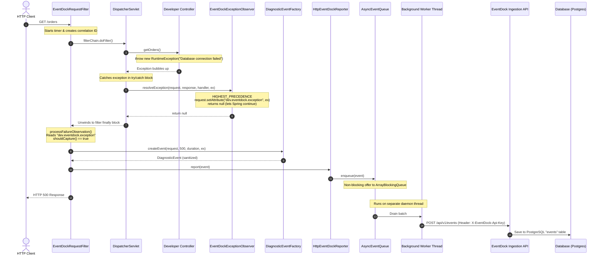

# How EventDock Starter Captures Exceptions Internally (In Simple Words)

This guide explains in clear, simple language how the `eventdock-starter` library detects, captures, and reports errors in a developer's Spring Boot application without requiring any manual try-catch code.

---

## 1. The Core Question

Suppose a developer adds this single dependency to their `pom.xml`:

```xml
<dependency>
    <groupId>dev.swynx</groupId>
    <artifactId>eventdock-starter</artifactId>
    <version>0.1.0</version>
</dependency>
```

And in their code, they write a simple controller:

```java
@GetMapping("/orders")
public String getOrders() {
    throw new RuntimeException("Database connection failed");
}
```

The developer never calls EventDock. They never write a try-catch block.

### How does EventDock get that `RuntimeException` object?

* **Who gives the exception to EventDock?**  
  Spring MVC's core controller dispatcher: `DispatcherServlet`.
* **Which EventDock component receives it first?**  
  [`EventDockExceptionObserver`](file:///c:/Shibu/Everything/Dev/eventdock/eventdock-starter/src/main/java/dev/eventdock/starter/instrumentation/EventDockExceptionObserver.java#L14).
* **What causes that component to execute?**  
  When an exception escapes a controller method, `DispatcherServlet` catches it and immediately asks all registered `HandlerExceptionResolver` components to help resolve it.
* **Why does EventDock get to see it before anything else?**  
  Because `EventDockExceptionObserver` declares `Ordered.HIGHEST_PRECEDENCE`. Spring sorts it to position #1 in line, calling it before `@ExceptionHandler` or `@RestControllerAdvice` can touch it.
* **How does the exception get sent without breaking the user's app?**  
  `EventDockExceptionObserver` stashes the exception in the HTTP request as an attribute (`dev.eventdock.exception`) and returns `null`. Returning `null` tells Spring: *"I took note of this, but I did not handle it—continue normal processing."*
* **How does it reach the reporting code?**  
  [`EventDockRequestFilter`](file:///c:/Shibu/Everything/Dev/eventdock/eventdock-starter/src/main/java/dev/eventdock/starter/filter/EventDockRequestFilter.java#L24) sits as an outer wrapper around the whole HTTP request. In its `finally` block, it pulls the stashed exception out of the request attribute, builds a diagnostic event, sanitizes it, and drops it into a background queue.

---

## 2. A Simple Analogy

Think of an HTTP request like a customer walking into a restaurant:

1. **The Greeter at the Front Door (`EventDockRequestFilter`):**  
   Pins a badge on the customer with a unique ID (`X-Request-Id`) and starts a timer.
2. **The Kitchen / Chef (Developer's Controller):**  
   While cooking, something catches fire (`throw new RuntimeException("Database connection failed")`).
3. **The Kitchen Manager (`DispatcherServlet`):**  
   Catches the pan fire and yells for emergency responders (`HandlerExceptionResolver`).
4. **The Silent Inspector (`EventDockExceptionObserver`):**  
   Stands at the very front of the responder line (`HIGHEST_PRECEDENCE`). Takes a quick photo of the fire, writes down the error in a pocket notebook (`request.setAttribute("dev.eventdock.exception", ex)`), and steps aside (`return null`) so the restaurant's normal safety team (`@ExceptionHandler`) can handle it.
5. **The Customer Leaves:**  
   The front door greeter (`EventDockRequestFilter` `finally` block) checks the pocket notebook on the way out. Seeing that a fire occurred, the greeter writes an incident report and drops it into an outbox for the delivery driver (`AsyncEventQueue`).
6. **The Customer's Experience:**  
   The customer gets whatever error response the restaurant designed (or the default 500 error page). The app was never slowed down or disrupted.

---

## 3. Step-by-Step Code Execution Path

Here is the exact step-by-step path through the real code:



### The 16 Detailed Steps in Code:

1. **Incoming Request:** An HTTP GET request hits Tomcat or Jetty.
2. **Filter Interception:** [`EventDockRequestFilter.doFilterInternal`](file:///c:/Shibu/Everything/Dev/eventdock/eventdock-starter/src/main/java/dev/eventdock/starter/filter/EventDockRequestFilter.java#L46) starts a timer, gets or creates an `X-Request-Id` correlation ID, and wraps the rest of the call in `try { filterChain.doFilter(...) } catch (Throwable t) { ... } finally { ... }` (lines 62–72).
3. **DispatcherServlet Dispatch:** Spring's `DispatcherServlet.doDispatch` routes `/orders` to the controller.
4. **Exception Thrown:** Controller executes `throw new RuntimeException("Database connection failed");`.
5. **JVM Stack Unwinding:** The JVM halts normal execution and unwinds call stack frames until it reaches `DispatcherServlet.doDispatch`'s catch block.
6. **Exception Observer Invocation:** `DispatcherServlet` calls `processHandlerException()`, which loops through all `HandlerExceptionResolver` beans.
7. **Recording the Error:** [`EventDockExceptionObserver.resolveException`](file:///c:/Shibu/Everything/Dev/eventdock/eventdock-starter/src/main/java/dev/eventdock/starter/instrumentation/EventDockExceptionObserver.java#L25) executes first (`HIGHEST_PRECEDENCE`, line 21). It calls `request.setAttribute("dev.eventdock.exception", ex)` (line 31) and returns `null` (line 35).
8. **Spring Resolution:** Spring calls subsequent resolvers (like `@ExceptionHandler` or Spring Boot's `/error` forwarder).
9. **Filter Finally Block:** The call returns to `EventDockRequestFilter`'s `finally` block (line 68).
10. **Extracting the Error:** [`processFailureObservation`](file:///c:/Shibu/Everything/Dev/eventdock/eventdock-starter/src/main/java/dev/eventdock/starter/filter/EventDockRequestFilter.java#L74) checks if the request was already reported (line 79). It reads `request.getAttribute("dev.eventdock.exception")` (lines 90–93).
11. **Evaluating Failure:** `shouldCapture(statusCode, exception)` returns `true` because the exception is not null (line 119). Line 98 marks `request.setAttribute("dev.eventdock.reported", Boolean.TRUE)`.
12. **Event Assembly & Scrubbing:** [`DiagnosticEventFactory.createEvent`](file:///c:/Shibu/Everything/Dev/eventdock/eventdock-starter/src/main/java/dev/eventdock/starter/capture/DiagnosticEventFactory.java#L32) extracts HTTP method, URI, route pattern, duration, error message, and stack trace (capped at 50 frames). [`SensitiveDataRedactor`](file:///c:/Shibu/Everything/Dev/eventdock/eventdock-starter/src/main/java/dev/eventdock/starter/sanitize/SensitiveDataRedactor.java#L15) replaces sensitive headers (`Authorization`, `Cookie`, `X-Api-Key`) with `***REDACTED***`.
13. **Submitting to Reporter:** [`HttpEventDockReporter.report(event)`](file:///c:/Shibu/Everything/Dev/eventdock/eventdock-starter/src/main/java/dev/eventdock/starter/reporting/HttpEventDockReporter.java#L49) is called.
14. **Non-Blocking Queue:** The event is placed into an `ArrayBlockingQueue` inside [`AsyncEventQueue.enqueue(event)`](file:///c:/Shibu/Everything/Dev/eventdock/eventdock-starter/src/main/java/dev/eventdock/starter/reporting/AsyncEventQueue.java#L66). **The user's HTTP thread finishes immediately and returns the HTTP response.**
15. **Background Delivery:** A daemon thread named `"eventdock-queue-worker"` wakes up every second, takes events from the queue, and uses Java's built-in `HttpClient` to POST JSON to `/api/v1/events` with header `X-EventDock-Api-Key`.
16. **API Storage:** In `eventdock-api`, [`ApiKeyAuthenticationFilter`](file:///c:/Shibu/Everything/Dev/eventdock/eventdock-api/src/main/java/dev/eventdock/api/security/ApiKeyAuthenticationFilter.java#L21) validates the SHA-256 key hash, [`EventController`](file:///c:/Shibu/Everything/Dev/eventdock/eventdock-api/src/main/java/dev/eventdock/api/controller/EventController.java#L28) validates the DTO, and [`EventService`](file:///c:/Shibu/Everything/Dev/eventdock/eventdock-api/src/main/java/dev/eventdock/api/service/EventService.java#L27) saves it into PostgreSQL table `events`.

---

## 4. How Auto-Configuration Works

How does Spring know to turn all this on just because the JAR was added to Maven?

### 1. Spring Boot 3 Discovery
Spring Boot 3 looks inside every JAR on the classpath for this exact file:  
`META-INF/spring/org.springframework.boot.autoconfigure.AutoConfiguration.imports`

In `eventdock-starter`, that file lists:
```
dev.eventdock.starter.EventDockAutoConfiguration
```

### 2. Safety Conditions
In [`EventDockAutoConfiguration.java`](file:///c:/Shibu/Everything/Dev/eventdock/eventdock-starter/src/main/java/dev/eventdock/starter/EventDockAutoConfiguration.java#L25-L29):

```java
@AutoConfiguration
@ConditionalOnWebApplication(type = ConditionalOnWebApplication.Type.SERVLET)
@ConditionalOnProperty(prefix = "eventdock", name = "enabled", havingValue = "true", matchIfMissing = true)
@EnableConfigurationProperties(EventDockProperties.class)
public class EventDockAutoConfiguration
```

* **`@ConditionalOnWebApplication(type = SERVLET)`**: Only activates if the application is a traditional servlet web app. (It won't interfere with CLI tools or reactive WebFlux apps).
* **`matchIfMissing = true`**: Enabled by default. The developer can disable it anytime with `eventdock.enabled=false`.

### 3. Automatic Bean Wiring
Spring Boot creates these beans automatically:
* `EventDockRequestFilter`: Spring Boot registers any bean implementing Servlet `Filter` into the web container filter chain.
* `EventDockExceptionObserver`: Spring MVC discovers any bean implementing `HandlerExceptionResolver` and attaches it to `DispatcherServlet`.
* `HttpEventDockReporter` & `AsyncEventQueue`: Configures the network client and background thread worker.

---

## 5. Edge Cases: What Happens in Different Scenarios?

| Scenario | What Happens? | Is It Captured? | Why? |
| :--- | :--- | :---: | :--- |
| **Case A:** Controller throws an unhandled exception | The exception reaches `DispatcherServlet` and is stashed by `EventDockExceptionObserver`. Filter sees 500 status. | **Captured** | Full stack trace and request details are recorded. |
| **Case B:** Developer has their own `@ExceptionHandler` | `EventDockExceptionObserver` runs *before* the developer's handler because of `HIGHEST_PRECEDENCE`. Developer's handler still executes normally. | **Captured** | EventDock captures the original exception while preserving the developer's custom error response. |
| **Case C:** Controller catches the exception internally and returns HTTP 200 | The exception never escapes the controller method. Status is 200. | **Not Captured** | The JVM never surfaces the exception to Spring MVC or the Filter. |
| **Case D:** Controller manually returns HTTP 500 without throwing an exception | No exception object exists, but HTTP status is 500. | **Captured** | Captured as an HTTP failure (`errorType: HTTP_500`, `stackTrace: null`). |
| **Case E:** A `@Service` throws an exception | The exception bubbles up through the controller to `DispatcherServlet`. | **Captured** | Handled identically to Case A. |
| **Case F:** Failure in a `@Scheduled` job or `@Async` method | Runs on a background thread without an HTTP request or `DispatcherServlet`. | **Not Captured** | EventDock Starter is strictly servlet-request based. |
| **Case G:** Failure in a Security Filter before controller | Depends on filter order. | **Conditional** | If the failing filter is *after* `EventDockRequestFilter`, it is captured. If it runs *before*, EventDock never sees it. |
| **Case H:** EventDock backend is offline | Reporting HTTP request fails or times out. | **Host Unaffected** | Exception is logged at debug level on the background thread. The host app never crashes or hangs. |
| **Case I:** EventDock code throws an internal error | Filter has internal `try-catch` blocks around reporting. | **Host Unaffected** | Swallowed safely to protect the host application. |
| **Case J:** Spring Boot `/error` default dispatch | Initial request is captured. Forward to `/error` is skipped. | **Captured** | `dev.eventdock.reported` flag and `/error` in `excludedPaths` prevent duplicate reports. |

---

## 6. Honest Limitations

* **Swallowed errors are invisible:** If application code catches an error and returns HTTP 200, EventDock cannot detect it.
* **Non-HTTP code is not monitored:** `@Scheduled` cron jobs, Kafka listeners, RabbitMQ consumers, and `@Async` background threads are not monitored.
* **Early security filter failures may be missed:** If a security filter rejects a token before `EventDockRequestFilter` in the filter chain, the error may bypass EventDock unless routed to `/error`.
* **Queue capacity limit:** The background queue holds up to 500 events by default. If the EventDock backend is down and errors pour in faster than they can be sent, subsequent events are dropped to prevent exhausting host memory.

---

## 7. Recommended Future Improvements

1. **Explicit High Filter Precedence:** Register `EventDockRequestFilter` with a `FilterRegistrationBean` at `Ordered.HIGHEST_PRECEDENCE + 10` to sit before Spring Security filters.
2. **Log Appender Support:** Add an optional Logback / SLF4J appender to capture errors when developers call `log.error("...", ex)`.
3. **Async Error Support:** Provide an `AsyncUncaughtExceptionHandler` bean to capture exceptions from `@Async` methods.

---

## 8. Exact Files to Read in the Codebase

To verify everything explained here, read these files in order:

1. [`dev/eventdock/starter/instrumentation/EventDockExceptionObserver.java`](file:///c:/Shibu/Everything/Dev/eventdock/eventdock-starter/src/main/java/dev/eventdock/starter/instrumentation/EventDockExceptionObserver.java#L14)  
   *See how the exception is intercepted at `HIGHEST_PRECEDENCE` and stored in a request attribute.*
2. [`dev/eventdock/starter/filter/EventDockRequestFilter.java`](file:///c:/Shibu/Everything/Dev/eventdock/eventdock-starter/src/main/java/dev/eventdock/starter/filter/EventDockRequestFilter.java#L46)  
   *See how the request is wrapped and the stashed exception is retrieved in the `finally` block.*
3. [`dev/eventdock/starter/EventDockAutoConfiguration.java`](file:///c:/Shibu/Everything/Dev/eventdock/eventdock-starter/src/main/java/dev/eventdock/starter/EventDockAutoConfiguration.java#L25)  
   *See how Spring Boot automatically wires these components.*
4. [`dev/eventdock/starter/capture/DiagnosticEventFactory.java`](file:///c:/Shibu/Everything/Dev/eventdock/eventdock-starter/src/main/java/dev/eventdock/starter/capture/DiagnosticEventFactory.java#L32)  
   *See how exception messages, stack traces, and request details are packaged.*
5. [`dev/eventdock/starter/reporting/AsyncEventQueue.java`](file:///c:/Shibu/Everything/Dev/eventdock/eventdock-starter/src/main/java/dev/eventdock/starter/reporting/AsyncEventQueue.java#L22)  
   *See how the non-blocking background queue keeps the user's application fast.*

